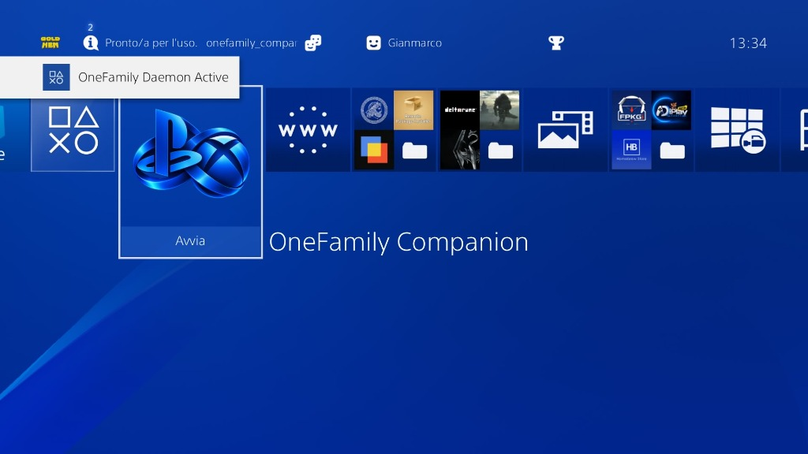
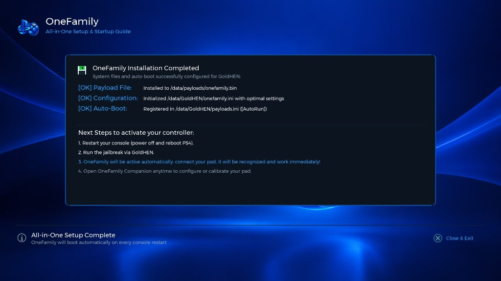
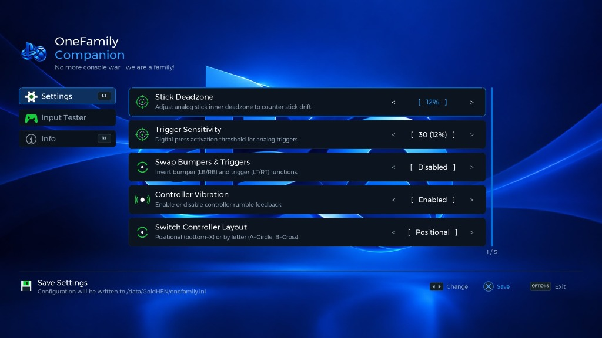
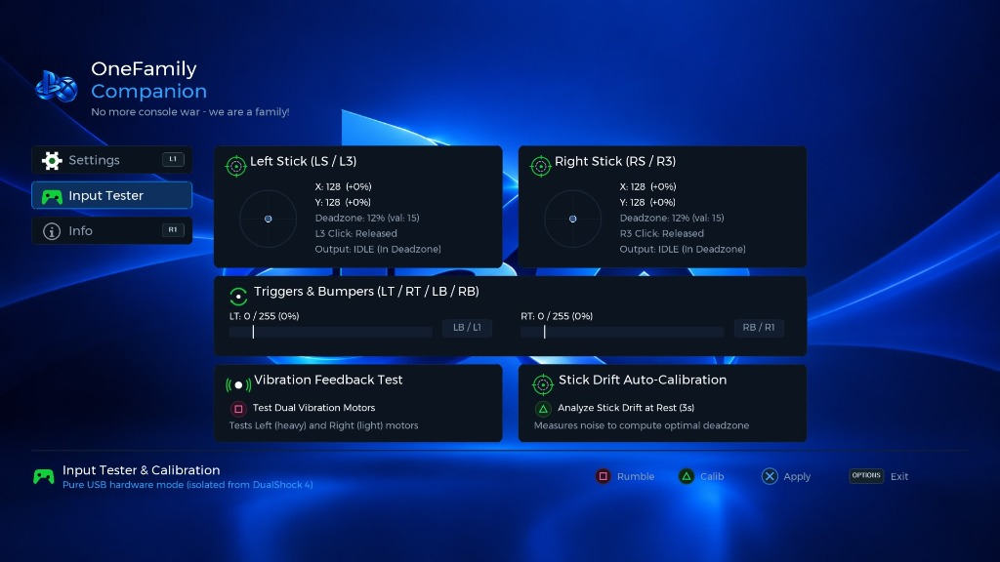

<p align="center">
  
</p>

<h1 align="center">OneFamily</h1>
<p align="center">
  <b>Universal USB Controller Daemon & Companion App for PlayStation 4</b><br>
  <i>"No more console war - we are a family!"</i>
</p>

<p align="center">
  
  
  
  
  
</p>

---

## Overview

**OneFamily** is a high-performance background daemon and 1080p companion homebrew application for jailbroken PlayStation 4 consoles running **GoldHEN**.

It allows you to connect virtually any USB controller — including **Sony DualSense & DualSense Edge (PS5)**, **all XInput-compatible PC gamepads**, **Generic USB HID & DirectInput controllers** (Logitech F310/F710, 8BitDo in D-Input mode, etc.), **Google Stadia**, official and third-party **Xbox controllers** (Xbox 360, Xbox One, Xbox Series X|S), **Nintendo Switch** controllers, and Sony **DualShock 3** — and play across the entire PS4 operating system and all games with **zero input lag**, full analog precision, and hardware rumble feedback.

Unlike traditional game-specific hooks that only intercept inputs inside running titles, OneFamily operates as an independent, system-level background daemon. It registers connected gamepads directly into the PlayStation 4 pad subsystem (`libScePad`) as genuine Type 1 DualShock 4 devices. This provides complete OS integration: you can log into any user account, switch profiles on the fly, access the system Quick Menu, navigate the XMB dashboard, and play local multiplayer titles just like an official Sony controller.

---

## Screenshots

<p align="center">
  <b>PS4 Dashboard & Auto-Boot Notification</b><br>
  
</p>

<p align="center">
  <b>All-in-One Automated Setup Guide</b><br>
  
</p>

<p align="center">
  <b>Settings & Configuration (Real-Time INI Reload)</b><br>
  
</p>

<p align="center">
  <b>Hardware Input Tester & Drift Auto-Calibration</b><br>
  
</p>

---

## Key Features

- **Native System-Wide DualShock 4 Emulation:** Registers controllers directly into `libScePad` as official Type 1 DualShock 4 devices. Unlike user-space game hooks, it functions seamlessly across the entire console environment—including the XMB dashboard, system settings, media applications, PlayStation Store, and all retail or homebrew titles.
- **Multi-User Profile Login & Profile Switching:** Fully integrated with the PS4 User Service (`libSceUserService`). When you plug in a controller or press the Guide/PS button, you can assign it to any profile on the console (Player 1, Player 2, or Guest), enabling native local co-op and split-screen multiplayer across different accounts.
- **Complete Quick Menu & Shell Navigation:** The Guide/PS button provides native PlayStation Home functionality. Tap to return to the XMB dashboard, or hold to open the PlayStation Quick Menu (to adjust audio, manage power options, or suspend applications).
- **Universal XInput & Third-Party Xbox Support:** Comprehensive hardware descriptor detection supporting official Microsoft controllers as well as licensed and third-party gamepads (PowerA, PDP, 8BitDo, Razer, Hori, Nacon, Thrustmaster, GameSir, Logitech, and generic PC XInput devices).
- **Generic USB HID & DirectInput Support:** Full support for non-XInput USB gamepads via dynamic HID report descriptor parsing (axes, buttons, and hat-switch D-Pad).
- **Visual Button Remapping GUI (Remap HID Tab):** A dedicated 4th tab in the companion app when an HID gamepad is plugged in. Remap any physical button to PlayStation actions with authentic icons, and auto-save hardware profiles to `/data/onefamily/controllers/<VID>_<PID>.ini`.
- **Dedicated R3 Test Mode:** Press R3 to toggle between Edit Mode and Test Mode inside the remapping screen. Test buttons in real-time without triggering UI navigation or accidental saving.
- **Universal Home / Touchpad Combos:** For 12-button controllers lacking physical PS/Touchpad buttons:
  - **Back + Start** or **Share + D-Pad Down** = PS Button (Home / Quick Menu)
  - **Share + D-Pad Up** = Touchpad Click
- **Ultra-Low Latency (250 Hz Polling):** Operates on an unthrottled 4 ms polling loop for competitive, instantaneous input response with zero latency overhead.
- **Unified Filesystem (`/data/onefamily`):** Centralized directory for configuration (`onefamily.ini`), custom controller profiles (`controllers/`), and runtime logs.
- **All-in-One Automated Setup:** The companion app handles full deployment on first launch:
  - Deploys the background daemon payload to `/data/payloads/onefamily.bin`.
  - Configures `/data/GoldHEN/payloads.ini` for automatic boot on system start (`[AutoRun]`).
  - Initializes `/data/onefamily/onefamily.ini` with optimal default settings.
- **Analog Stick Drift Auto-Calibration:** Measures resting stick noise across 180 frames (~3 seconds) and automatically calculates the minimal ideal deadzone to eliminate drift while preserving responsiveness.
- **Dual Vibration / Rumble Support:** Full support for large (heavy) and small (light) rumble motors, including a dedicated hardware vibration tester in the companion app.
- **On-the-Fly USB Hotplugging:** Plug, unplug, or switch controllers anytime without needing to restart the game or console.
- **Customizable Controls:**
  - Stick Deadzones: 0% up to 25%.
  - Trigger Activation Thresholds.
  - Swap Bumpers and Triggers (L1/R1 <-> L2/R2).
  - Nintendo Switch Button Layout: Positional (A=Circle, B=Cross) or By Letter.
  - Xbox Guide Button Mapping: Native PS Button or Touchpad Click.

---

## Supported Controllers

| Controller Family | Model / Vendor | Connection | Vibration | Drift Calibration |
| :--- | :--- | :---: | :---: | :---: |
| **All PC XInput Gamepads** | Standard XInput & DirectInput/XInput hybrids | USB | Yes | Yes |
| **Xbox Third-Party Controllers** | PowerA, PDP, 8BitDo, Razer, Hori, Nacon, Thrustmaster, GameSir | USB | Yes | Yes |
| **Microsoft Xbox Series X \| S** | Official Wireless Controller (USB-C cable) | USB | Yes | Yes |
| **Microsoft Xbox One / S / X / Elite** | Official Wireless Controller (Micro-USB cable) | USB | Yes | Yes |
| **Microsoft Xbox 360** | Official Wired Controller & third-party clones | USB | Yes | Yes |
| **Generic USB HID & DirectInput** | Logitech F310, F710, RumblePad 2, 8BitDo (D-Input), generic PC pads | USB | Yes | Yes |
| **Google Stadia Controller** | Official Stadia Controller (USB-C cable) | USB | Yes | Yes |
| **Nintendo Switch Pro Controller** | Official Pro Controller & third-party Switch pads | USB | — | Yes |
| **Sony PlayStation 3 DualShock 3** | Official DualShock 3 (automatic handshake) | USB | Yes | Yes |
| **Sony PlayStation 5 DualSense / Edge** | Official DualSense & DualSense Edge | USB | *In development* | *In development* |

> [!NOTE]
> **Sony PlayStation 5 DualSense Support:** Support for Sony DualSense and DualSense Edge controllers is currently in active development and will be available in an upcoming release.

---

## Quick Start / Installation

1. **Install the Companion App:**
   - Download `onefamily_companion.pkg` from the [Releases](../../releases) page.
   - Install it on your PS4 via GoldHEN Package Installer.

2. **First-Time Setup (All-in-One):**
   - Open **OneFamily Companion** from your PS4 dashboard.
   - The app will automatically install the payload and configure GoldHEN auto-boot.

3. **Reboot & Enjoy:**
   - Restart your console and enable GoldHEN.
   - A notification **"OneFamily Daemon Active"** will appear on the top-left of the screen.
   - Plug in your USB controller — it works instantly!

4. **Customize & Calibrate:**
   - Launch **OneFamily Companion** anytime to calibrate stick drift, test vibration, remap HID buttons, or adjust settings. Changes apply in real time!

---

## Building from Source

### Prerequisites
- OpenOrbis PS4 Toolchain
- LLVM Clang / LLD (`clang`, `ld.lld`)
- .NET 8 / 9 SDK (for `PkgTool.Core`)
- Python 3.x

### Build Commands (PowerShell)

```powershell
# 1. Build the OneFamily background daemon payload
.\build_daemon.ps1

# 2. Build and package the Companion App PKG
.\build_app.ps1
```

The compiled binaries will be output to:
- `bin/onefamily.bin` (Daemon payload)
- `bin/onefamily_companion.pkg` (PS4 Companion Package)

---

## License

This project is licensed under the **MIT License** - see the [LICENSE](LICENSE) file for details.
