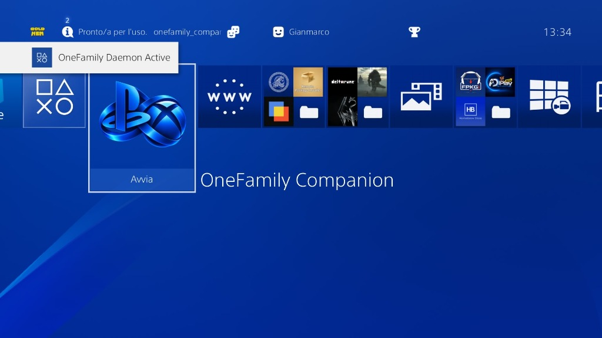
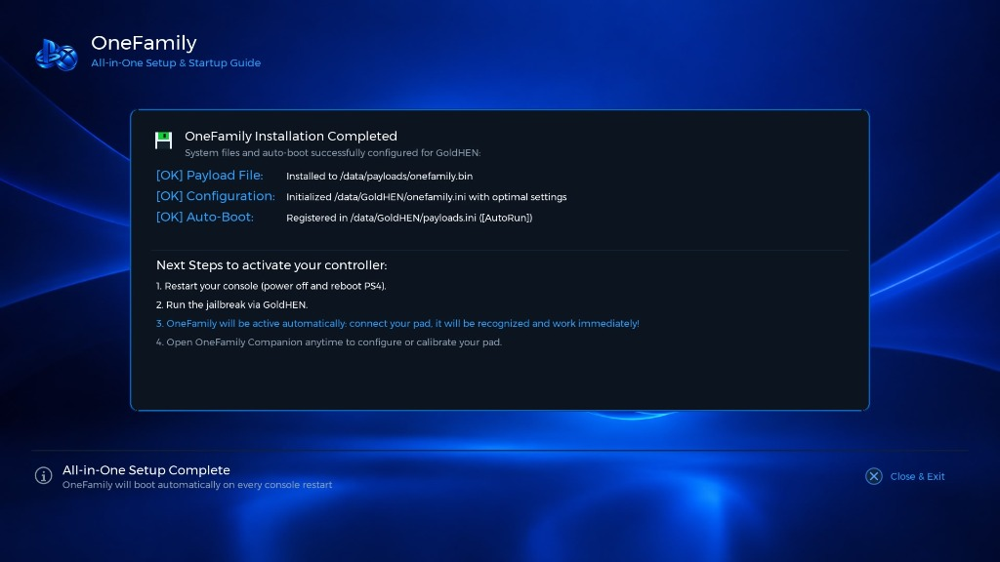
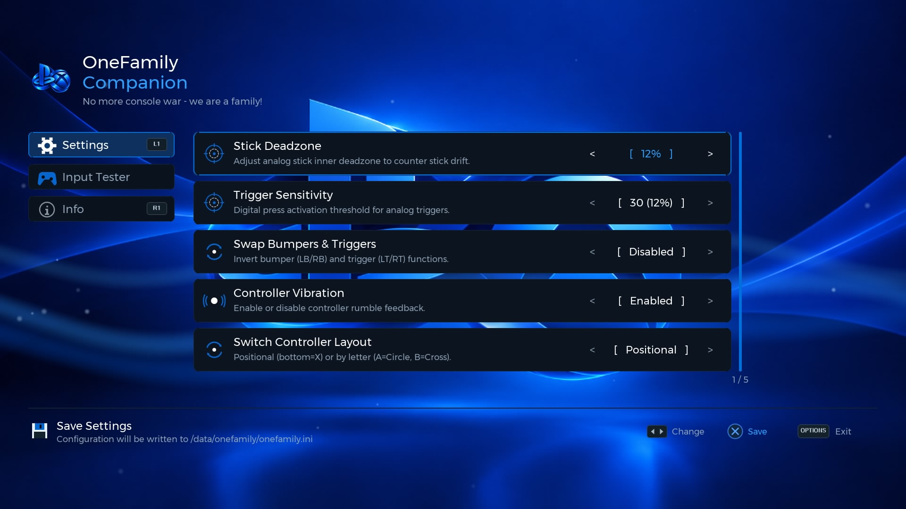
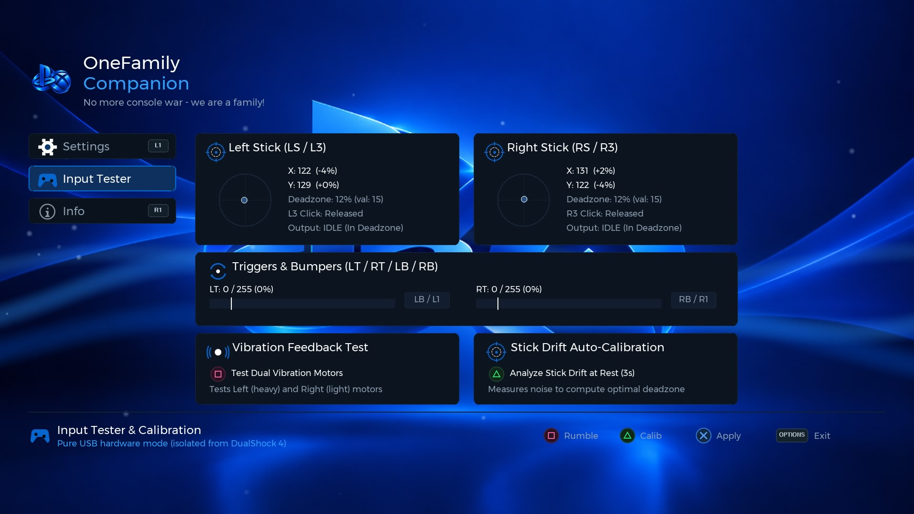
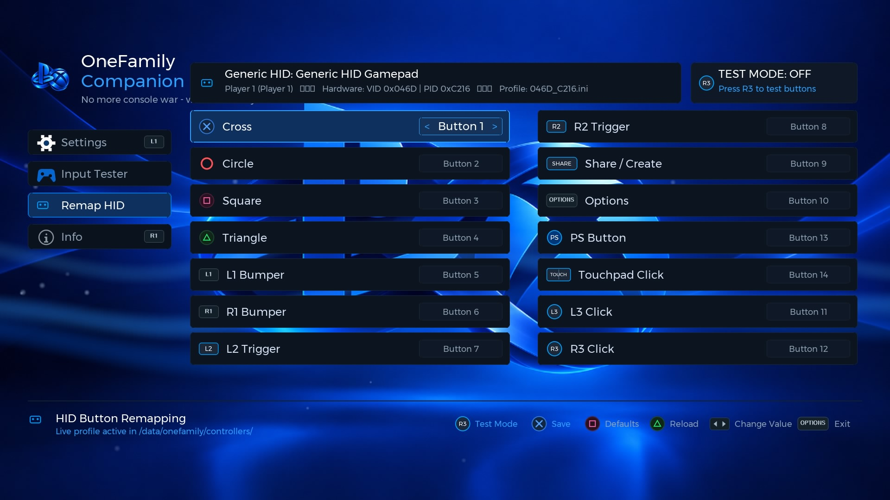
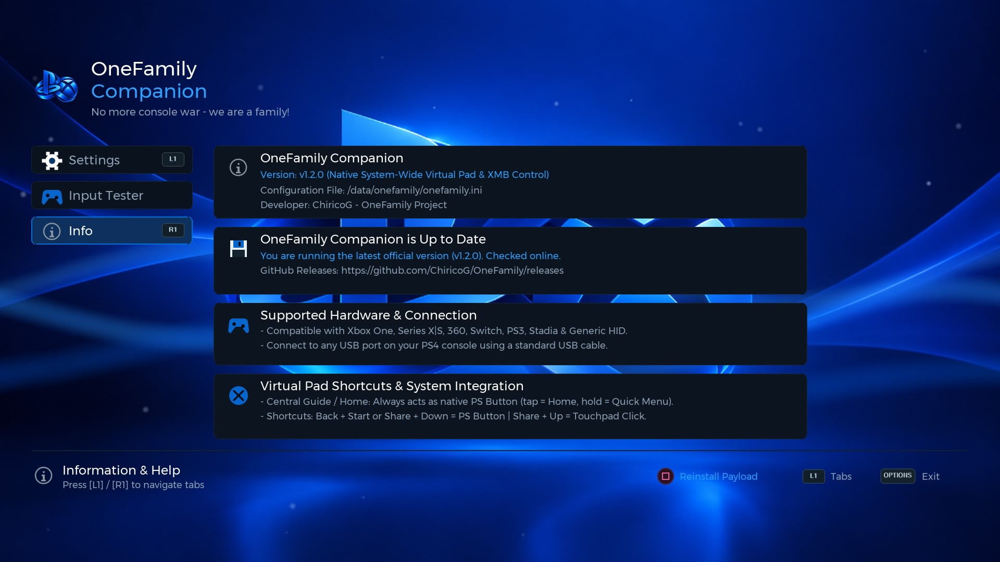

<p align="center">
  
</p>

<h1 align="center">OneFamily</h1>
<p align="center">
  <b>Universal USB & Bluetooth (DualSense) Controller Daemon & Companion App for PlayStation 4</b><br>
  <i>"No more console war - we are a family!"</i>
</p>

<p align="center">
  = 2.4b18.10"/>
  
  
  
  
</p>

---

## Table of Contents

- [Overview](#overview)
- [Screenshots](#screenshots)
- [Key Features](#key-features)
- [Supported Controllers](#supported-controllers)
- [System Requirements](#system-requirements)
- [Quick Start / Installation](#quick-start--installation)
- [Bug Reports & Requesting New Controllers](#bug-reports--requesting-new-controllers)
- [Building from Source](#building-from-source)
- [Credits & Acknowledgements](#credits--acknowledgements)
- [License](#license)

---

## Overview

**OneFamily** is a high-performance background daemon and 1080p companion homebrew application for jailbroken PlayStation 4 consoles running **GoldHEN**.

It allows you to connect virtually any gamepad — including **Sony DualSense & DualSense Edge (PS5 via native Bluetooth)**, **all XInput-compatible PC gamepads**, **Generic USB HID & DirectInput controllers** (Logitech F310/F710, 8BitDo in D-Input mode, etc.), **Google Stadia**, official and third-party **Xbox controllers** (Xbox 360, Xbox One, Xbox Series X|S via USB), **Nintendo Switch** controllers, and Sony **DualShock 3** — and play across the entire PS4 operating system and all games with **zero input lag**, full analog precision, and hardware rumble feedback.

Unlike traditional game-specific hooks that only intercept inputs inside running titles, OneFamily operates as an independent, system-level background daemon. It registers connected gamepads directly into the PlayStation 4 pad subsystem (`libScePad`) as genuine Type 1 DualShock 4 devices. This provides complete OS integration: you can log into any user account, switch profiles on the fly, access the system Quick Menu, navigate the XMB dashboard, and play local multiplayer titles just like an official Sony controller.

---

## Screenshots

<p align="center">
  <b>PS4 Dashboard & Auto-Boot Notification</b><br>
  
</p>

<p align="center">
  <b>All-in-One Automated Setup Guide</b><br>
  
</p>

<p align="center">
  <b>Settings & Configuration (Real-Time INI Reload)</b><br>
  
</p>

<p align="center">
  <b>Hardware Input Tester & Drift Auto-Calibration</b><br>
  
</p>

<p align="center">
  <b>Visual Button Remapping GUI (Generic USB HID Gamepads)</b><br>
  
</p>

<p align="center">
  <b>System Info & In-App Online Update Service</b><br>
  
</p>

---

## Key Features

- **Native System-Wide DualShock 4 Emulation:** Registers controllers directly into `libScePad` as official Type 1 DualShock 4 devices. Unlike user-space game hooks, it functions seamlessly across the entire console environment—including the XMB dashboard, system settings, media applications, PlayStation Store, and all retail or homebrew titles.
- **Multi-DualSense & DualSense Edge Wireless Engine (Bluetooth - FW 9.00 to 13.52+):** Seamless wireless connectivity for up to 4 Sony DualSense and DualSense Edge controllers concurrently. Each connected controller is registered to an independent player slot (Player 1 - Player 4) with dedicated RGB lightbar illumination, battery status monitoring, capacitive touchpad emulation, and 250 Hz reporting. Powered by verified zero-delay static kernel tables for **FW 9.00, FW 11.00, FW 12.50, and FW 13.52**, backed by a universal fallback pattern scanner for all other supported versions. *(On firmwares prior to 9.00 such as FW 5.05, 6.72, and 7.xx, the Bluetooth driver is cleanly and safely skipped to protect the kernel, while all USB controllers remain 100% active).*
- **DualSense In-Game Built-In Speaker Audio (Bluetooth):** Full in-game controller audio streaming directly through the DualSense internal speaker over native PS4 Bluetooth (`SCE_AUDIO_OUT_PORT_TYPE_PADSPK`). Hear walkie-talkie dispatches and phone calls in *Grand Theft Auto V*, flashlight clicks and tape recordings in *The Last of Us Remastered*, and BB cries in *Death Stranding* directly from your gamepad while the main game audio mix (music, environmental sounds, dialogue) remains 100% active on your TV/monitor. Includes active Bluetooth link continuity (500 ms heartbeat) to eliminate audio dropouts and Sniff Mode power-saving stutter.
- **Calibrated Hardware Adaptive Triggers (DualSense Presets):** Real-time hardware trigger motor control via extended Output Report `0x31` for L2 and R2. Features 3 finely calibrated physical modes selectable in the Companion App:
  - *Hair Trigger*: Fast tactical snap-click at 12%-31% of trigger travel with maximum resisting force (0xFF) for competitive shooters.
  - *Continuous Resistance*: Smooth, uniform mechanical resistance (100/255) across the full trigger stroke for racing and simulation titles.
  - *Vibration / Pulsation*: Active 12 Hz tactile pulsation simulating weapon recoil or engine rumble.
  - *Standard / Off*: Actively disengages the internal motors and releases gear tension for conventional play.
- **6-Axis Motion Sensor Emulation & Gyro Aiming (250 Hz):** Full hardware gyroscope and accelerometer support for Sony DualSense and Nintendo Switch Pro controllers. Processes raw sensor telemetry with factory hardware calibration, computes real-time quaternion spatial orientation, and feeds 6-axis motion data into Orbis OS at 250 Hz for precision gyro aiming in titles such as *The Last of Us Part II*, *Days Gone*, *Gravity Rush*, and *Uncharted*.
- **Smart DualSense USB Bypass & Charging:** Connecting a DualSense via USB leaves the port active as a safe 5V power supply to charge the controller while displaying an on-screen toast guiding the user to pair wirelessly via Bluetooth, preventing audio/endpoint hardware stalls.
- **Dedicated DualSense Configuration Tab (Companion App):** A dedicated configuration tab for PlayStation 5 DualSense gamepads. Offers per-slot RGB lightbar color picking, graphical battery charge level display, LED brightness intensity, adaptive trigger presets, player indicator LED modes, and **Card 5: Internal Speaker Volume** (interactive 0% to 100% volume slider, visual progress gauge, and instant Mute/Unmute toggle via the Square button). Featuring **Instant Live Push**: saving your configuration pushes parameters directly to active controllers in real time without requiring a console reboot or daemon restart.
- **High-Performance 60 FPS RAM Backbuffer & Latency-Free Input Batching:** Companion App rendering engine featuring double-buffered 1080p RAM backbuffering to eliminate HDMI scanline tearing and visual flickering. Drives the UI at a fluid 30-60 FPS while employing 16-sample `scePadRead` batch polling to guarantee that rapid D-Pad taps and analog stick motions are registered with zero input drop.
- **Multi-User Profile Login & Profile Switching:** Fully integrated with the PS4 User Service (`libSceUserService`). When you plug in a controller or press the Guide/PS button, you can assign it to any profile on the console (Player 1, Player 2, or Guest), enabling native local co-op and split-screen multiplayer across different accounts.
- **Complete Quick Menu & Shell Navigation:** The Guide/PS button provides native PlayStation Home functionality. Tap to return to the XMB dashboard, or hold to open the PlayStation Quick Menu (to adjust audio, manage power options, or suspend applications).
- **Universal XInput & Third-Party Xbox Support:** Comprehensive hardware descriptor detection supporting official Microsoft controllers as well as licensed and third-party gamepads (PowerA, PDP, 8BitDo, Razer, Hori, Nacon, Thrustmaster, GameSir, Logitech, and generic PC XInput devices).
- **Generic USB HID & DirectInput Support:** Full support for non-XInput USB gamepads via dynamic HID report descriptor parsing (axes, buttons, and hat-switch D-Pad).
- **Visual Button Remapping GUI (Remap HID Tab):** A dedicated 4th tab in the companion app when an HID gamepad is plugged in. Remap any physical button to PlayStation actions with authentic icons, and auto-save hardware profiles to `/data/onefamily/controllers/<VID>_<PID>.ini`.
- **Dedicated R3 Test Mode:** Press R3 to toggle between Edit Mode and Test Mode inside the remapping screen. Test buttons in real-time without triggering UI navigation or accidental saving.
- **Universal Home / Touchpad Combos:** For 12-button controllers lacking physical PS/Touchpad buttons:
  - **Back + Start** or **Share + D-Pad Down** = PS Button (Home / Quick Menu)
  - **Share + D-Pad Up** = Touchpad Click
- **Ultra-Low Latency (250 Hz Polling):** Operates on an unthrottled 4 ms polling loop for competitive, instantaneous input response with zero latency overhead.
- **Unified Filesystem & Canonical `/user/data` Fallback:** Centralized directory for configuration (`onefamily.ini`), custom controller profiles (`controllers/`), and runtime logs with dual `/data` and canonical `/user/data` fallback support across all firmware versions, guaranteeing zero setup issues even on FW 5.05 where `/data` is not symlinked.
- **All-in-One Automated Setup:** The companion app handles full deployment on first launch:
  - Deploys the background daemon payload to `/data/payloads/onefamily.bin`.
  - Configures `/data/GoldHEN/payloads.ini` for automatic boot on system start (`[AutoRun]`).
  - Initializes `/data/onefamily/onefamily.ini` with optimal default settings.
- **In-App Online Package Updater:** Integrated online update service within the Companion App's Info tab. Queries GitHub Releases directly to detect new versions and downloads `.pkg` update packages in the background into `/data/pkg/`, ready for immediate installation via the GoldHEN Package Installer.
- **Hardware Input Tester & Analog Stick Drift Auto-Calibration:** Comprehensive diagnostic interface with automatic active controller focus (moving an analog stick or pressing any button instantly switches the view to that gamepad's slot). Features **Isolated Test Mode (R3 Toggle)** to lock the active player tab, enabling full-throw analog stick and trigger testing without accidental slot switching. Measures resting stick noise across 180 frames (~3 seconds) to automatically calculate the optimal deadzone to eliminate drift while preserving maximum sensitivity.
- **Dual Vibration / Rumble Support:** Full support for large (heavy) and small (light) rumble motors, including a dedicated hardware vibration tester in the companion app.
- **On-the-Fly USB Hotplugging:** Plug, unplug, or switch controllers anytime without needing to restart the game or console.
- **Customizable Controls:**
  - Stick Deadzones: 0% up to 25%.
  - Trigger Activation Thresholds.
  - Swap Bumpers and Triggers (L1/R1 <-> L2/R2).
  - Nintendo Switch Button Layout: Positional (A=Circle, B=Cross) or By Letter.
  - Xbox Guide Button Mapping: Native PS Button or Touchpad Click.

---

## Supported Controllers

| Controller Family | Model / Vendor | Connection | Vibration | Drift Calibration |
| :--- | :--- | :---: | :---: | :---: |
| **All PC XInput Gamepads** | Standard XInput & DirectInput/XInput hybrids | USB | Yes | Yes |
| **Xbox Third-Party Controllers** | PowerA, PDP, 8BitDo, Razer, Hori, Nacon, Thrustmaster, GameSir | USB | Yes | Yes |
| **Microsoft Xbox Series X \| S** | Official Wireless Controller (USB-C cable) | USB | Yes | Yes |
| **Microsoft Xbox One / S / X / Elite** | Official Wireless Controller (Micro-USB cable) | USB | Yes | Yes |
| **Microsoft Xbox 360** | Official Wired Controller & third-party clones | USB | Yes | Yes |
| **Generic USB HID & DirectInput** | Logitech F310, F710, RumblePad 2, 8BitDo (D-Input), generic PC pads | USB | Yes | Yes |
| **Google Stadia Controller** | Official Stadia Controller (USB-C cable) | USB | Yes | Yes |
| **Nintendo Switch Pro Controller** | Official Pro Controller & third-party Switch pads | USB | — | Yes (incl. 6-Axis Motion / Gyro) |
| **Sony PlayStation 3 DualShock 3** | Official DualShock 3 (automatic handshake) | USB | Yes | Yes |
| **Sony PlayStation 5 DualSense / Edge** | Official DualSense & DualSense Edge | **Bluetooth (Wireless - FW 9.00+)** | Yes | Yes (incl. Speaker Audio, Triggers & Gyro) |

> [!TIP]
> **How to Pair Sony PlayStation 5 DualSense / Edge via Bluetooth:**
> 1. With the controller powered off, press and hold the **Create (Share)** and **PS** buttons simultaneously until the lightbar rapidly blinks blue (pairing mode).
> 2. On your PS4, navigate to **Settings > Devices > Bluetooth Devices**.
> 3. Select **Wireless Controller** and confirm the pairing prompt. OneFamily will automatically hook into the Bluetooth subsystem and register the DualSense as an active system controller!
> 
> *Firmware Compatibility:*
> - **USB Controllers (All Models):** 100% supported across **all GoldHEN firmwares (FW 5.05 up to 13.52+)**.
> - **DualSense Bluetooth (Wireless):** Up to 4 controllers simultaneously supported on **FW 9.00 up to 13.52+** (pre-verified zero-delay static tables for **FW 9.00, FW 11.00, FW 12.50, and FW 13.52**; universal dynamic VID-First AOB scanner for all other supported firmwares).
> - *(Note for FW < 9.00 like 5.05/6.72/7.xx: PS5 DualSense Bluetooth is not supported by legacy PS4 kernels; OneFamily cleanly disables the BT subsystem on FW < 9.00 to guarantee 0 panics, while all USB gamepads function at full 250 Hz).*
> - *(Note on USB: The USB port is reserved for charging the DualSense battery — OneFamily will guide you to connect via Bluetooth if plugged into USB).*

---

## System Requirements

| Component | Minimum Requirement | Notes |
| :--- | :--- | :--- |
| **PS4 Firmware** | **FW 5.05 up to 13.52+** | Full USB support across all firmwares; Bluetooth DualSense on FW 9.00+. |
| **Jailbreak Exploit** | **Any Exploit** | Fully compatible with **PPPwn**, **POOBs4**, **VueAfterFree (FW 12.50)**, etc. |
| **GoldHEN Version** | **≥ 2.4b18.10** *(Recommended: 2.4b18.12+)* | **Mandatory.** Required for background ELF user service stability and AutoRun. |

> [!IMPORTANT]
> **Why GoldHEN ≥ 2.4b18.10 is strictly required:**
> - **ELF User Service Stability:** Earlier GoldHEN releases (such as 2.4b18.9) contained a known issue where calls into `libSceUserService` hung indefinitely inside background ELF payloads, preventing the virtual controller from being assigned to user profiles. This was resolved in GoldHEN 2.4b18.10 (*"Fixed sceUserServiceInitialize failure on ELF payloads"*).
> - **AutoRun LaunchPad Support:** GoldHEN 2.4b18.10 officially added PayLoader AutoRun support (`[AutoRun]` in `/data/GoldHEN/payloads.ini`). Older versions ignore auto-boot directives.
> - If you are using **VueAfterFree on FW 12.50**, simply update your GoldHEN payload to **2.4b18.10 or newer (e.g. 2.4b18.12)** and OneFamily will auto-boot and operate flawlessly!
>
> *(Ensure **Settings > GoldHEN > PayLoader > Enable AutoRun** is checked on your console).*

---

## Quick Start / Installation

1. **Install the Companion App:**
   - Ensure your PS4 is running **GoldHEN ≥ 2.4b18.10** (recommended **2.4b18.12+**) with **Settings > GoldHEN > PayLoader > Enable AutoRun** checked.
   - Download `onefamily_companion.pkg` from the [Releases](../../releases) page.
   - Install it on your PS4 via GoldHEN Package Installer.

2. **First-Time Setup (All-in-One):**
   - Open **OneFamily Companion** from your PS4 dashboard.
   - The app will automatically install the payload and configure GoldHEN auto-boot.

3. **Reboot & Enjoy:**
   - Restart your console and enable GoldHEN.
   - A notification **"OneFamily Daemon Active"** will appear on the top-left of the screen.
   - Plug in your USB controller or connect your DualSense via Bluetooth — it works instantly!

4. **Customize & Calibrate:**
   - Launch **OneFamily Companion** anytime to calibrate stick drift, test vibration, remap HID buttons, or adjust settings. Changes apply in real time!

---

## Bug Reports & Requesting New Controllers

Encountered a bug, crash, or have a controller that isn't recognized yet? We're actively expanding OneFamily and welcome community feedback!

Please open an issue on our [GitHub Issues Tracker](https://github.com/ChiricoG/OneFamily/issues).

### Requesting Support for a New Controller

To help us add support for your gamepad quickly, please include:
1. **Controller Brand & Exact Model** (e.g., *Razer Wolverine V2*, *8BitDo Ultimate 2.4G*, *Flydigi Vader 3 Pro*).
2. **Connection Type** (USB or 2.4 GHz wireless USB dongle).
3. **OPTIONAL: Hardware Identifiers (VID & PID)**:
   - Check `/data/onefamily/onefamily.log` on your PS4, or connect the controller to a PC (Device Manager > Hardware IDs).
4. **Behavior on PS4**: What happens when plugged in (e.g., does the notification appear, is it detected as Generic HID, or completely ignored?).

### Reporting Bugs

Please **follow the Bug Report template**

---

## Building from Source

### Prerequisites
- OpenOrbis PS4 Toolchain
- LLVM Clang / LLD (`clang`, `ld.lld`)
- .NET 8 / 9 SDK (for `PkgTool.Core`)
- Python 3.x

### Build Commands (PowerShell)

```powershell
# 1. Build the OneFamily background daemon payload
.\build_daemon.ps1

# 2. Build and package the Companion App PKG
.\build_app.ps1
```

The compiled binaries will be output to:
- `bin/onefamily.bin` (Daemon payload)
- `bin/onefamily_companion.pkg` (PS4 Companion Package)

---

## Credits & Acknowledgements

- **[Diram1x](https://github.com/Diramix)**: **Special thanks** for the pioneering research on PS4 Bluetooth allowlist patching and DualSense wireless HID communication, which inspired and served as the technical foundation for OneFamily's native Bluetooth DualSense integration.

---

## License

This project is licensed under the **MIT License** - see the [LICENSE](LICENSE) file for details.
